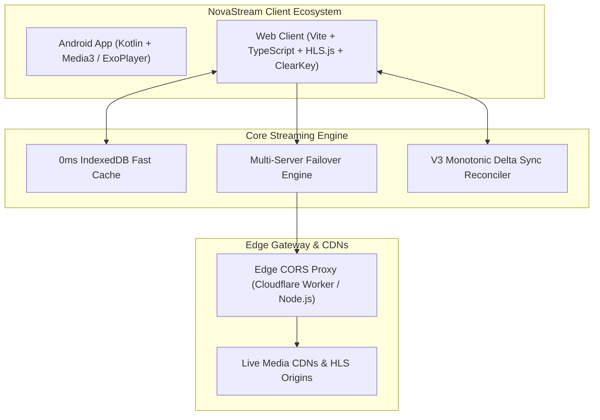

# NovaStream Platform

[](https://opensource.org/licenses/MIT)
[](https://github.com/Etcodehub/Nova-Stream/actions)
[](https://www.typescriptlang.org/)
[](https://vitejs.dev/)

> **NovaStream is a multi-platform media streaming ecosystem** combining a native Android TV/Mobile client with an enterprise-grade Web Streaming Platform featuring 0ms IndexedDB caching, V3 monotonic delta synchronization, dynamic multi-source server failover, ClearKey DRM support, and edge CORS manifest rewriting.

---

## 🌟 Platform Components



---

## 💻 1. Web Streaming Platform (`src/`)

Adapted from reverse-engineered native streaming architectures to solve browser-specific hurdles (MSE, EME, CORS):

* **0ms Fast Cache (`src/cache/FastCacheManager.ts`):** Restores channels and program metadata instantly from browser **IndexedDB** (`NovaStream_FastCache`) on startup before any network calls.
* **Multi-Source Failover Engine (`src/player/SourceManager.ts`):** Automatically rotates candidate server mirrors (`Server 1`, `Server 2 (Backup)`, `Server 3`) when encountering fatal segment errors or prolonged buffer stalls (> 6s).
* **V3 Monotonic Delta Sync (`src/sync/DeltaSyncService.ts`):** Syncs only incremental catalog updates using an `activeRevision` integer, avoiding heavy full-catalog downloads.
* **Edge CORS Gateway (`src/gateway/`):** Both a Node.js proxy (`corsProxy.ts`) and a Cloudflare Worker script (`worker.ts`) that rewrite `.m3u8` playlists and inject CORS headers (`Access-Control-Allow-Origin: *`).
* **ClearKey EME Integration (`src/player/NovaPlayer.ts`):** W3C Encrypted Media Extensions support for ClearKey protected streams.

### Web Quickstart
```bash
# Install dependencies
npm install

# Start local web development server
npm run dev

# Run unit tests
npm test

# Build production bundle
npm run build
```

---

## 📱 2. Native Android App (`app/`)

* **Engine:** AndroidX Media3 / ExoPlayer.
* **Stream Protocols:** HLS (`.m3u8`), MPEG-DASH (`.mpd`), and progressive MP4 playback.
* **M3U Playlist Parser:** Metadata parsing for channel names, groups, logos, and custom request headers (`User-Agent`, `Referer`, `Cookie`).
* **CI/CD:** Automated GitHub Actions build workflow (`.github/workflows/android.yml`) that builds and uploads the debug APK.

### Android Build
```bash
# Build debug APK locally
./gradlew assembleDebug
```
Output location: `app/build/outputs/apk/debug/app-debug.apk`

---

## 📁 Repository Structure

```text
Nova-Stream/
├── .github/workflows/
│   └── android.yml                # Automated Android APK CI/CD workflow
├── app/                           # Native Android Media3 Kotlin app
│   ├── build.gradle.kts
│   └── src/main/java/com/novastream/android/
├── src/                           # NovaStream Web Streaming Core
│   ├── types/                     # TypeScript domain models
│   ├── cache/FastCacheManager.ts  # 0ms IndexedDB cache
│   ├── sync/DeltaSyncService.ts   # V3 Delta Sync protocol
│   ├── player/SourceManager.ts    # Multi-source failover engine
│   ├── player/NovaPlayer.ts       # HLS / ClearKey EME player engine
│   ├── gateway/                   # CORS proxies (Node.js & Cloudflare Worker)
│   ├── mockData.ts                # Verified live test streams
│   ├── style.css                  # Modern dark-mode streaming UI
│   └── main.ts                    # UI entrypoint & orchestrator
├── test/
│   └── streaming_core.test.js     # Unit test suite
├── catalog.json                   # 79 curated live channels
├── wrangler.jsonc                 # Cloudflare Worker edge configuration
├── vite.config.ts                 # Vite bundler configuration
├── tsconfig.json                  # TypeScript compiler settings
└── package.json
```

---

## 📄 License
This project is licensed under the MIT License.
